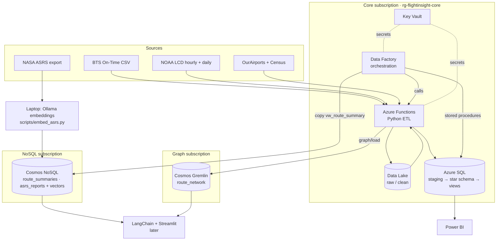

# Architecture

## Data flow

## Monthly pipeline (one ADF run per month_key)

1. `bts/ingest`, `noaa/ingest` (Functions) — download to `raw/`, clean + UTC + validate to `clean/`
2. `bts/load`, `noaa/load` (Functions) — delete-and-reload the month in SQL staging
3. Stored Procedure activities — staging → dimensions → facts → `agg_route_monthly`
4. Copy activity — `vw_route_summary` → Cosmos `route_summaries`
5. `graph/load` (Function) — yearly route edges → Gremlin
6. Every step writes to `etl_load_log`; bad rows go to `stg_rejected`

ASRS embeddings are a one-off batch run from a laptop, not part of the monthly pipeline.

## Decisions (changes from the P2 design)

| Decision | Why |
|---|---|
| ADF + Azure Functions instead of local Airflow | Fully cloud-hosted and deployable by CI/CD; no always-on Airflow server to pay for; the data is a 2024 backfill so orchestration needs are light |
| Data Lake landing zone (`raw` / `clean`) | Re-runs don't re-download; raw files are kept for audit |
| Each `ingest` / `load` is a separate Function call | The ADF Azure Function activity times out at about 230 s |
| Components spread across three student subscriptions | Each subscription gets its own Azure SQL free offer and one Cosmos free-tier account |
| Two SQL databases: `flightinsight` (prod) and `flightinsight-dev` | Free; experiments in dev can't break the pipeline; prod changes only via `main` |
| No local databases or Docker | Everyone works against the same cloud state; the SQL project is validated in CI without a database |
| SQL Database Project (declarative) instead of migration scripts | The repo always shows each table's current shape; CI catches broken references; data-loss changes are blocked |
| Cosmos throughput hard-capped at 1000 RU/s | Stays inside the free tier |
